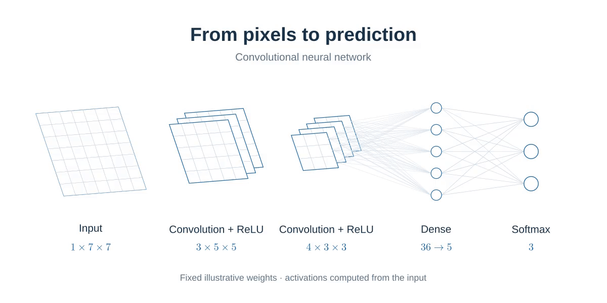

# TensorQuill

TensorQuill is a project for explaining machine learning concepts through figures and animations for research and presentations. It draws on [ManimML](https://github.com/helblazer811/manimml) [](https://github.com/helblazer811/manimml) and the Manim Community Gallery.



**Work in progress** · Original TensorQuill animation made with Manim, inspired by [ManimML’s CNN showcase](https://github.com/helblazer811/ManimML#first-neural-network).

> [!IMPORTANT]
> This was done for the sole purpose of visualizing outputs / presentations!

[About the project](https://syudu41.github.io/visualizer/about/) · [Sample visualizations](https://syudu41.github.io/visualizer/samples/)

Edit website pages in `website/`, then build or preview:

```sh
python3 scripts/website.py build
python3 scripts/website.py preview
```

See the [website editing guide](docs/website.md) for cards, pages, and setup.

