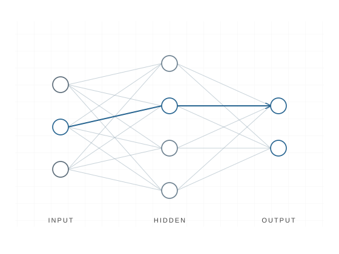

# The forward pass

A neural network passes information from its input through hidden layers to produce a prediction. Each layer combines its inputs with learned weights and applies an activation function before passing the result onward.

This is a schematic concept preview, not a generated Manim render. A future animation will trace how values change through the network.

[Back to sample visualizations](index.md)
