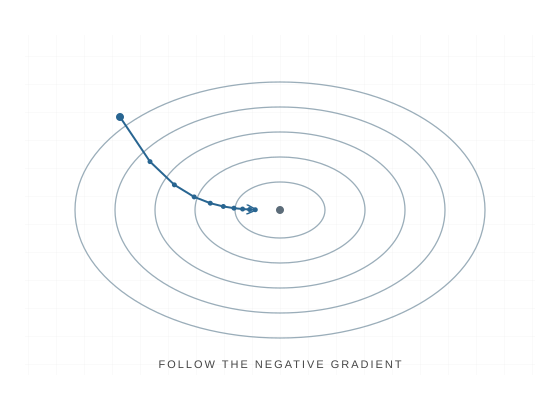

# Gradient descent

Gradient descent updates model parameters in the direction that locally reduces a loss function. This contour view shows successive steps approaching a minimum; the path depends on the starting point and learning rate.

This is a schematic concept preview, not a generated Manim render. A future animation will connect each update to the slope of the loss.

[Back to sample visualizations](index.md)
