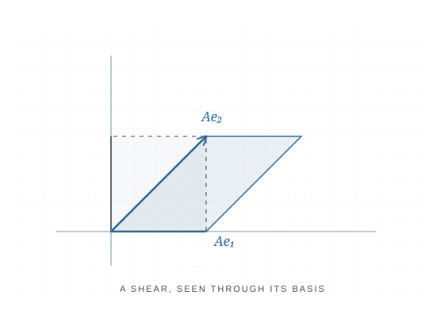

# Linear transformations

A linear transformation can be understood by following what happens to the basis directions. A shear moves one direction while preserving the other, turning a square into a parallelogram.

This is a schematic concept preview, not a generated Manim render. A future animation will connect the movement of the basis vectors to the transformation of the whole plane.

[Back to sample visualizations](index.md)
