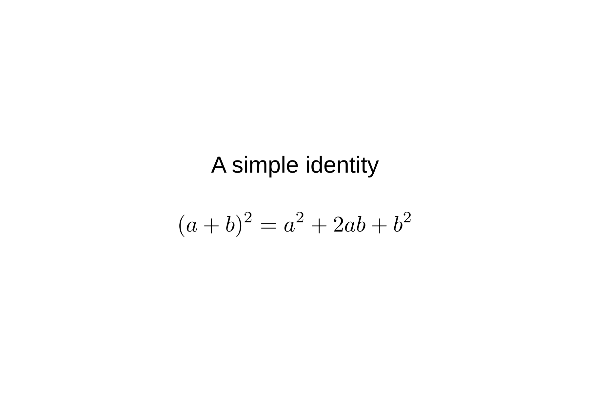

# A simple identity

Expanding the square of a sum gives the two square terms and twice their product. This example checks that prose and LaTeX mathematics render clearly together.

[Download visualization](assets/rendering-check/visualization.png)

[Back to sample visualizations](index.md)
