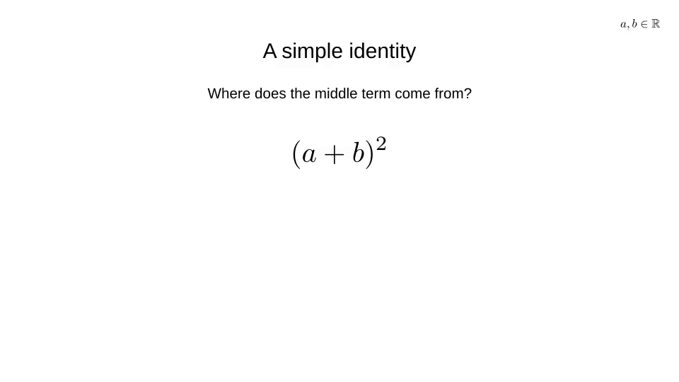

# A simple identity

The beauty of visualization is seeing why a formula works: each product appears, then matching terms combine. Inspired by [3Blue1Brown’s visual approach to mathematical understanding](https://www.3blue1brown.com/lessons/essence-of-calculus/).

[Download visualization](assets/rendering-check/visualization.gif)

[Back to sample visualizations](index.md)
